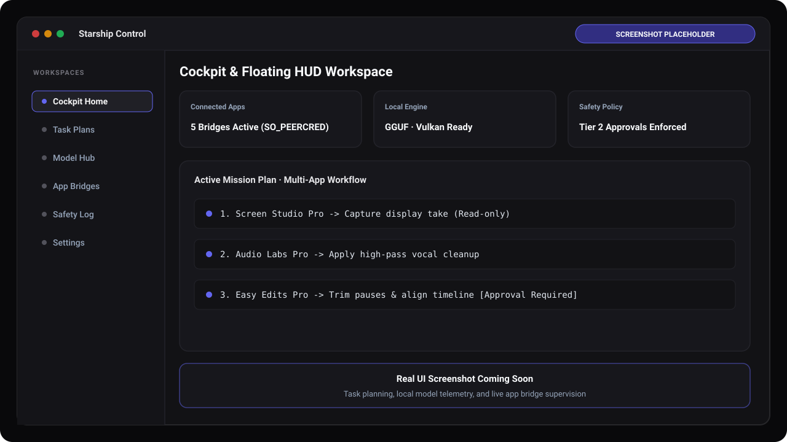
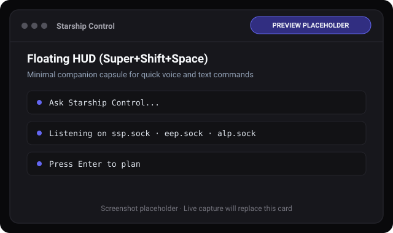
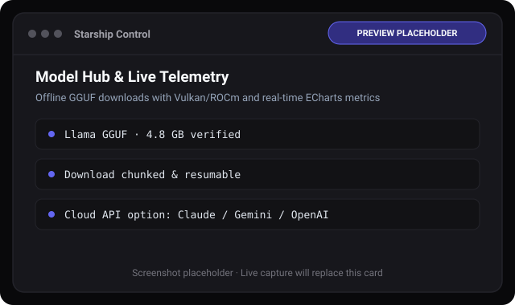
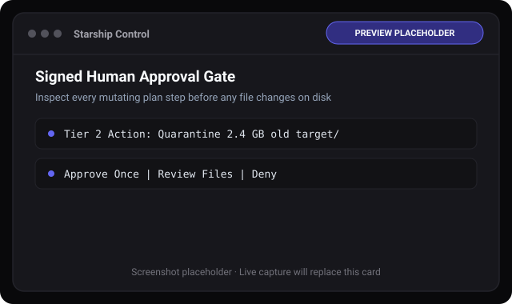
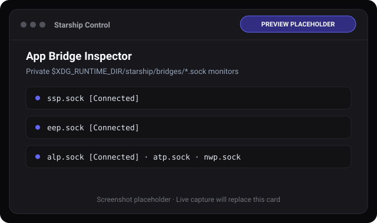
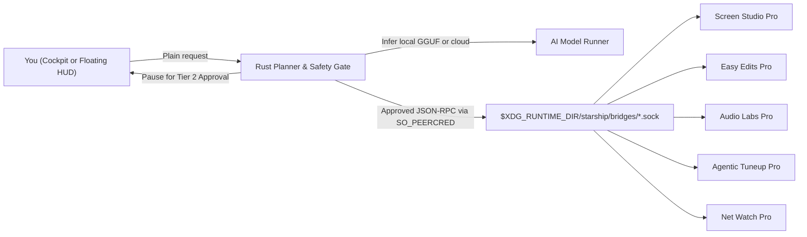

<div align="center">
  <a id="top"></a>
  <p>
    
  </p>

  <h1>Starship Control</h1>

  <h3>A local-first AI cockpit and floating command bar for your Linux desktop</h3>

  <p>
    Ask for tasks in plain words, review every planned step, and keep your files completely private on your own computer.
  </p>

  <p>
    <a href="https://www.zvirox.in">Website</a> ·
    <a href="https://github.com/zvirox/starship-control/releases">Download Packages</a> ·
    <a href="#quick-installation">Quick Install</a> ·
    <a href="#key-features">Features</a> ·
    <a href="#connected-app-suite">App Suite</a> ·
    <a href="#maintainer-and-ecosystem">Maintainer</a> ·
    <a href="#frequently-asked-questions">FAQ</a>
  </p>

  <p>
    <a href="https://github.com/zvirox/starship-control/actions/workflows/ci.yml">
      
    </a>
    <a href="LICENSE">
      
    </a>
    
    
  </p>

  <table>
    <tr>
      <td align="right"><b>Start</b></td>
      <td align="center"><a href="#what-is-starship-control">What It Is</a></td>
      <td align="center"><a href="#workspace-previews">Previews</a></td>
      <td align="center"><a href="#quick-installation">Install</a></td>
    </tr>
    <tr>
      <td align="right"><b>Features</b></td>
      <td align="center"><a href="#key-features">Key Capabilities</a></td>
      <td align="center"><a href="#how-it-works">How It Works</a></td>
      <td align="center"><a href="#safety-and-privacy">Safety Rules</a></td>
    </tr>
    <tr>
      <td align="right"><b>Suite</b></td>
      <td align="center"><a href="#connected-app-suite">Connected Apps</a></td>
      <td align="center"><a href="#real-world-examples">Prompt Examples</a></td>
      <td align="center"><a href="#tech-stack">Tech Stack</a></td>
    </tr>
    <tr>
      <td align="right"><b>Community</b></td>
      <td align="center"><a href="#frequently-asked-questions">FAQ</a></td>
      <td align="center"><a href="#maintainer-and-ecosystem">Maintainer</a></td>
      <td align="center"><a href="#license">License</a></td>
    </tr>
  </table>
</div>

<br />

<p align="center">
  
  <br />
  <sub><b>Screenshot placeholder.</b> Main Cockpit planning window showing connected desktop bridges and human approval gates.</sub>
</p>

---

## What is Starship Control?

Most desktop programs live on isolated islands. Your screen recorder saves a raw clip, your video editor waits for manual imports, your audio app handles noise cleanup separately, and your disk cleaner forces you to open a terminal. Moving projects between these apps takes tedious clicks every single day.

Starship Control links your desktop utilities into one calm workspace. It gives you a strategic **Cockpit** window for planning multi-step workflows and a lightweight **Floating HUD** that opens from any screen when you press `Super+Shift+Space`. Type what you want in everyday language. Starship Control drafts an action plan, coordinates the right companion apps locally, and pauses for your click before changing or deleting anything on disk.

You can run open AI models completely offline on your own graphics card or processor, or plug in an external cloud API key when you want hosted models.

---

## Workspace Previews

<table>
  <tr>
    <td width="50%" valign="top">
      <br />
      <strong>Floating HUD Companion</strong><br />
      Summon a compact command bar anywhere with <code>Super+Shift+Space</code> to check system stats or trigger actions fast.
    </td>
    <td width="50%" valign="top">
      <br />
      <strong>Model Hub and Telemetry</strong><br />
      Download open GGUF models directly from Hugging Face with pause, resume, hash checks, and live resource graphs.
    </td>
  </tr>
  <tr>
    <td width="50%" valign="top">
      <br />
      <strong>Human Approval Gates</strong><br />
      Read-only checks happen automatically. File edits, timeline trims, and cleanups pause until you approve them.
    </td>
    <td width="50%" valign="top">
      <br />
      <strong>Private App Bridges</strong><br />
      Detects running Zvirox desktop apps automatically over kernel-checked Linux Unix sockets with zero open web ports.
    </td>
  </tr>
</table>

---

## Key Features

- **Two Clean Windows**: Use the full **Cockpit** (`1200x800`) to organize long tasks and watch model downloads, or tap `Super+Shift+Space` for the compact **Floating HUD** (`520x76`) that stays out of your way.
- **Offline Local AI Engine**: Run open GGUF models directly on AMD, NVIDIA, Intel, or CPU hardware using `llama.cpp` with Vulkan and ROCm support. Nothing leaves your computer.
- **Built-in Model Downloader**: Browse Hugging Face models inside the app, fetch large files in resumable chunks, and verify file integrity automatically.
- **Optional Cloud Providers**: Connect your own keys for Anthropic Claude, OpenAI, Google Gemini, or OpenRouter whenever you prefer remote models.
- **Three-Tier Safety Lock**: Looking up stats or reading project status runs right away. Changing files or removing caches pauses at a signed approval prompt so nothing happens behind your back.
- **Zero-Config App Discovery**: Running companion apps publish a lightweight manifest locally so Starship Control connects immediately with no port forwarding or setup wizards.

---

## How It Works

Starship Control talks directly to your companion apps over private local Linux sockets instead of fragile UI clicks or remote servers.



### Step-by-Step Local Flow

1. **Automatic Discovery**: Each Zvirox app writes a small descriptor file to `$XDG_DATA_HOME/starship/plugins/` when it starts.
2. **Private Socket Channel**: Messages travel through local Unix domain sockets at `$XDG_RUNTIME_DIR/starship/bridges/`.
3. **Kernel User Verification**: Every socket checks Linux `SO_PEERCRED` credentials. Only programs running under your exact Linux user ID can talk to your apps.
4. **Prompt Safety Guardrails**: External text from window titles or filenames stays separated inside `<untrusted_context>` markers so stray file names cannot trick the assistant.

---

## Safety and Privacy

| Safety Tier | Allowed Without Asking? | Example Actions | How It Protects You |
| :--- | :---: | :--- | :--- |
| **Tier 1: Read-Only** | Yes | Check disk usage, inspect network speed, read timeline markers | Inspects status only without touching files |
| **Tier 2: Mutating** | **No** (Requires Click) | Trim video pauses, apply audio filters, move caches to quarantine | Pauses and shows exact plan before running |
| **Tier 3: Destructive** | **No** (Strict Gate) | Purge old quarantine sessions, modify protected packages | Demands explicit confirmation on HUD or Cockpit |

---

## Connected App Suite

Starship Control is optional. Every companion app works completely on its own. When you run them alongside Starship Control, they act like one unified workstation.

| App | What It Does Standalone | What Unlocks With Starship Control | Repository |
| :--- | :--- | :--- | :--- |
| **Screen Studio Pro** | Records screens, windows, audio, and webcam | Trigger captures, add chapter markers, and export by voice or text | [GitHub](https://github.com/zvirox/screen-studio-pro) · [Releases](https://github.com/zvirox/screen-studio-pro/releases) |
| **Easy Edits Pro** | Cuts and grades multitrack video projects | Remove silent pauses, assemble timelines, and generate synced captions | [GitHub](https://github.com/zvirox/easy-edits-pro) · [Releases](https://github.com/zvirox/easy-edits-pro/releases) |
| **Audio Labs Pro** | Records voices, cleans noise, and mixes tracks | Generate narration takes, strip room hum, and run multi-step mixes | [GitHub](https://github.com/zvirox/audio-labs-pro) · [Releases](https://github.com/zvirox/audio-labs-pro/releases) |
| **Agentic Tuneup Pro** | Scans junk files safely into reversible quarantine | Ask why your laptop fan is spinning or safely quarantine stale build folders | [GitHub](https://github.com/zvirox/agentic-tuneup-pro) · [Releases](https://github.com/zvirox/agentic-tuneup-pro/releases) |
| **Net Watch Pro** | Tracks real-time speed and per-app bandwidth | Ask which app is eating bandwidth today and inspect active endpoints | [GitHub](https://github.com/zvirox/net-watch-pro) · [Releases](https://github.com/zvirox/net-watch-pro/releases) |

### Real-World Examples

- *"Record a 60-second demo in Screen Studio Pro, remove background room hum in Audio Labs Pro, and open both clips on a timeline in Easy Edits Pro."*
- *"Check Net Watch Pro to see why my download speed dropped right now."*
- *"Scan my Projects folder with Agentic Tuneup Pro for old build caches older than 30 days and wait for my approval before moving them to quarantine."*

---

## Quick Installation

Prebuilt Linux packages and checksum files are published on the [Releases page](https://github.com/zvirox/starship-control/releases).

| Distribution | Package Format | Install Command |
| :--- | :--- | :--- |
| **Debian / Ubuntu / Pop!_OS / Mint** | `.deb` | `sudo apt install ./starship-control_*_amd64.deb` |
| **Fedora / RHEL / openSUSE** | `.rpm` | `sudo dnf install ./starship-control-*.x86_64.rpm` |
| **Arch Linux / Manjaro / CachyOS** | `.pkg.tar.zst` | `sudo pacman -U ./starship-control-*-x86_64.pkg.tar.zst` |

<details>
<summary><strong>Verify Checksums and Build From Source</strong></summary>

To verify downloaded files with `SHA256SUMS` from the release page:

```bash
sha256sum -c SHA256SUMS --ignore-missing
```

To build directly from source, install Rust stable, Node.js 22+, and standard desktop libraries (`libwebkit2gtk-4.1-dev`, `libgtk-3-dev`, `libayatana-appindicator3-dev`, `libssl-dev`, `libsqlite3-dev` on Debian/Ubuntu):

```bash
git clone https://github.com/zvirox/starship-control.git
cd starship-control
cd app && npm install && npm run build && cd ..
cargo build --release -p starship-control
```

</details>

---

## Tech Stack

| Layer | Technology | Role |
| :--- | :--- | :--- |
| **Desktop Shell** | Rust + Tauri 2 | Native Cockpit window, Floating HUD, tray menu, and OS integration |
| **Frontend UI** | React 19 + TypeScript + Tailwind CSS v4 | Solid matte dark interface with keyboard-first navigation |
| **Charts and State** | Apache ECharts 6 + Zustand | Real-time CPU/VRAM telemetry charts and reactive state management |
| **Local Inference** | `llama-cpp-2` (Vulkan / ROCm / CPU) | Private local GGUF text generation and Hugging Face model downloader |
| **Storage** | SQLite (WAL mode) + Secret Service | Task history, model index, audit logs, and encrypted key storage |
| **App Protocol** | MCP over Unix Sockets (`SO_PEERCRED`) | Authenticated local communication with companion Zvirox tools |

---

## Frequently Asked Questions

**Does Starship Control send my files or chats to the cloud?**
No. When you choose a local GGUF model, every prompt, file check, and inference step runs completely offline on your machine. If you manually add a cloud API key such as Claude or OpenAI, only the specific messages you submit to that cloud model travel over HTTPS.

**Can the AI delete files or change settings without my permission?**
No. The Rust safety layer checks every tool call before execution. Read-only lookups run automatically, while any action that alters files, cleans caches, edits timelines, or changes system settings pauses until you approve it on screen.

**Do I need a dedicated graphics card?**
No. While a Vulkan or ROCm GPU makes local models reply faster, Starship Control works on standard processors and also supports lightweight external APIs.

**How do I open the Floating HUD?**
Press `Super+Shift+Space` from any workspace on Linux to bring up the compact command capsule.

---

## Maintainer and Ecosystem

<p align="center">
  <a href="https://www.zvirox.in">
    
  </a>
</p>

<p align="center">
  <strong>Prakashpuri Gauswami (<a href="https://github.com/zvirox">@zvirox</a>)</strong><br />
  Cybersecurity Analyst &amp; SOC Practitioner · Agentic AI Builder · Blue Team &amp; SIEM · Patan, Gujarat, India
</p>

<p align="center">
  <a href="https://github.com/sponsors/zvirox">
    
  </a>
  <a href="https://ko-fi.com/zvirox">
    
  </a>
</p>

I build local-first open-source Linux and Android tools under **Zvirox**. Writing real software helps me study system boundaries and security architecture hands-on while giving creators and Linux users fast desktop tools free from subscriptions and telemetry.

### Connect and Support

- **GitHub Profile**: [github.com/zvirox](https://github.com/zvirox)
- **Website**: [www.zvirox.in](https://www.zvirox.in)
- **Email**: [info@zvirox.in](mailto:info@zvirox.in)
- **Sponsor**: [GitHub Sponsors](https://github.com/sponsors/zvirox) · [Ko-fi](https://ko-fi.com/zvirox)
- **Socials**: [LinkedIn (`in/plgsevala`)](https://www.linkedin.com/in/plgsevala) · [YouTube (`@zvirox_in`)](https://www.youtube.com/@zvirox_in) · [Instagram (`plg.sevala`)](https://www.instagram.com/plg.sevala) · [Facebook (`plg.sevala`)](https://www.facebook.com/plg.sevala)

### Zvirox App Suite (Open-Source Project List)

All six applications in the Zvirox desktop suite work standalone and connect together through Starship Control:

| Logo | Application | Purpose | Repository | Releases |
| :---: | :--- | :--- | :--- | :--- |
|  | **Starship Control** | Local-first AI desktop cockpit and floating HUD | [github.com/zvirox/starship-control](https://github.com/zvirox/starship-control) | [Releases](https://github.com/zvirox/starship-control/releases) |
|  | **Screen Studio Pro** | Wayland and X11 screen recorder with PipeWire | [github.com/zvirox/screen-studio-pro](https://github.com/zvirox/screen-studio-pro) | [Releases](https://github.com/zvirox/screen-studio-pro/releases) |
|  | **Easy Edits Pro** | Non-destructive multitrack video editor | [github.com/zvirox/easy-edits-pro](https://github.com/zvirox/easy-edits-pro) | [Releases](https://github.com/zvirox/easy-edits-pro/releases) |
|  | **Audio Labs Pro** | Offline voice studio and multitrack audio editor | [github.com/zvirox/audio-labs-pro](https://github.com/zvirox/audio-labs-pro) | [Releases](https://github.com/zvirox/audio-labs-pro/releases) |
|  | **Agentic Tuneup Pro** | Safety-first disk cleaner and system optimizer | [github.com/zvirox/agentic-tuneup-pro](https://github.com/zvirox/agentic-tuneup-pro) | [Releases](https://github.com/zvirox/agentic-tuneup-pro/releases) |
|  | **Net Watch Pro** | Real-time network speed and per-app data tracker | [github.com/zvirox/net-watch-pro](https://github.com/zvirox/net-watch-pro) | [Releases](https://github.com/zvirox/net-watch-pro/releases) |

---

## Star History

<p align="center">
  <a href="https://www.star-history.com/#zvirox/starship-control&Date">
    <picture>
      <source media="(prefers-color-scheme: dark)" srcset="https://api.star-history.com/svg?repos=zvirox/starship-control&type=Date&theme=dark" />
      <source media="(prefers-color-scheme: light)" srcset="https://api.star-history.com/svg?repos=zvirox/starship-control&type=Date" />
      
    </picture>
  </a>
</p>

---

## License

Starship Control is free, open-source software licensed under the [Apache License, Version 2.0](LICENSE).

<div align="center">
  <br />
  <a href="#top"><strong>Back to top</strong></a> · Built in public by <a href="https://www.zvirox.in">Zvirox</a>
</div>
