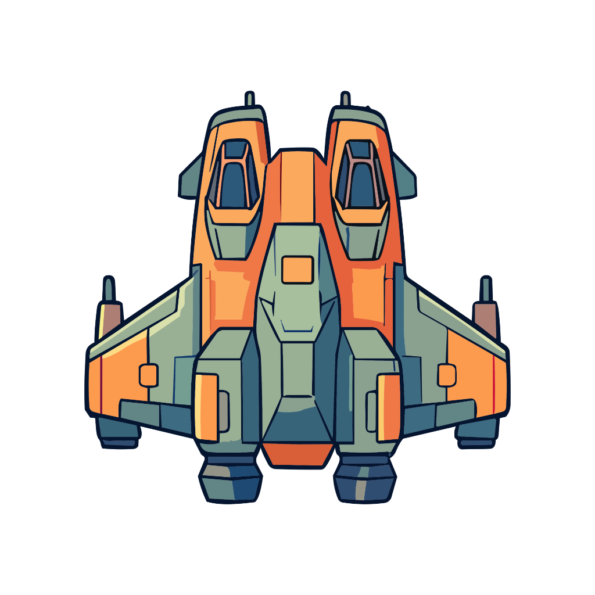

<p align="center">
  
  <h1 align="center">Starship Control</h1>
</p>

<p align="center">
  <strong>Native Linux AI agent orchestrator and unified command center for desktop applications</strong>
</p>

<p align="center">
  <a href="https://github.com/zvirox/starship-control/releases/tag/v0.1.0-alpha.1"></a>
  <a href="LICENSE"></a>
  <a href="#tech-stack"></a>
  <a href="#tech-stack"></a>
  <a href="#tech-stack"></a>
  <a href="#tech-stack"></a>
</p>

<p align="center">
  <a href="PRD.md">Product Requirements (PRD)</a> ·
  <a href="ARCHITECTURE.md">System Architecture</a> ·
  <a href="DESIGN.md">Design System</a> ·
  <a href="DATABASE.md">Database Schema</a> ·
  <a href="API.md">IPC & Protocols</a> ·
  <a href="PLAN.md">Roadmap & Plan</a> ·
  <a href="AGENTS.md">Contributor Rules</a>
</p>

---

## Overview

Most creative tools and desktop utilities run inside their own silos. A video editor knows nothing about your audio tracks until you export files manually. A screen recorder dumps files into a folder and expects you to cut pauses by hand. System monitors tell you when a disk fills up, but they leave cache cleanup to shell scripts.

**Starship Control** links these apps together. It is a native Linux mission control center that turns plain language goals into multi-app execution pipelines. You tell the agent what you want done, and Starship Control breaks the task into structured dependency graphs, routes commands to the right desktop tools via Model Context Protocol (MCP), and halts execution before any irreversible change takes effect.

```
┌────────────────────────────────────────────────────────────────────────┐
│                        STARSHIP CONTROL TOPOLOGY                       │
└────────────────────────────────────────────────────────────────────────┘

 [ USER SURFACES ]
   ┌────────────────────────────────┐    ┌───────────────────────────────┐
   │         COCKPIT WINDOW         │    │         FLOATING HUD          │
   │  1200×800 Strategic Workspace  │    │  520×76 Companion Glass Bar   │
   │  Mission Stream · Model Mgr    │    │  Global Shortcut: Super+Shift+Space
   │  App Topology · Pipeline Studio│    │  Dynamic Approval Expansion   │
   └───────────────┬────────────────┘    └───────────────┬───────────────┘
                   │                                     │
                   └──────────────────┬──────────────────┘
                                      │ Tauri IPC (`invoke` / `emit`)
                                      ▼
 [ STARSHIP CONTROL CORE (Rust 2024 / Tokio Runtime) ]
   ┌─────────────────────────────────────────────────────────────────────┐
   │                        STARSHIP ORCHESTRATOR                        │
   │   Task Sheet Planner (`tasksheet/1`) · Tiered Safety Arbiter        │
   │   Context Synthesizer · In-Memory Lease & Lock Supervisor           │
   └──────────────┬───────────────────┬───────────────────┬──────────────┘
                  │                   │                   │
                  ▼                   ▼                   ▼
   ┌──────────────────────┐ ┌──────────────────┐ ┌──────────────────────┐
   │    STARSHIP-INFER    │ │   STARSHIP-MCP   │ │     STARSHIP-DB      │
   │  Dual Engine Facade  │ │ Client Manager   │ │ SQLite Engine (WAL)  │
   ├──────────────────────┤ ├──────────────────┤ ├──────────────────────┤
   │ • Local: llama-cpp-2 │ │ • Unix Sockets   │ │ • missions & messages│
   │   (Vulkan/ROCm/CPU)  │ │   (SO_PEERCRED)  │ │ • plans & step DAG   │
   │ • Cloud: reqwest SSE │ │ • Stdio Spawner  │ │ • app_registry       │
   │   (OpenAI, Claude,   │ │ • Tool Discovery │ │ • models & providers │
   │    Gemini, OpenRouter│ │ • JSON-RPC 2.0   │ │ • audit_log (0600)   │
   │ • HF Chunked Downld  │ │                  │ │                      │
   │ • SHA-256 Verifier   │ │                  │ │                      │
   └──────────────────────┘ └─────────┬────────┘ └──────────────────────┘
                                      │
            ┌─────────────────────────┼─────────────────────────┐
            │ Unix Sockets (Live GUI) │ Stdio Pipes (CLI MCP)   │
            ▼                         ▼                         ▼
   ┌─────────────────┐       ┌─────────────────┐       ┌─────────────────┐
   │ EASY EDITS PRO  │       │SCREENSTUDIO PRO │       │ AUDIO LABS PRO  │
   │ (Video Editor)  │       │(Screen Recorder)│       │ (Voice Studio)  │
   │ starship-plugin │       │ starship-plugin │       │ starship-plugin │
   └─────────────────┘       └─────────────────┘       └─────────────────┘
            │                         │                         │
            ▼                         ▼                         ▼
   ┌─────────────────┐       ┌─────────────────┐       ┌─────────────────┐
   │  NET WATCH PRO  │       │AGENTIC TUNEUP PRO│      │  CUSTOM APPS    │
   │(Network Monitor)│       │ (System Cleaner)│       │(starship-plugin)│
   │ starship-plugin │       │ starship-plugin │       │ starship-plugin │
   └─────────────────┘       └─────────────────┘       └─────────────────┘
```

---

## Features

### Dual-Engine Intelligence
- **Local GGUF models:** Download and run open weights directly on hardware via `llama-cpp-2`. Supports Vulkan and ROCm GPU offloading with automatic CPU thread fallback.
- **In-app Hugging Face downloader:** Search GGUF repositories inside the app, resume interrupted downloads in chunks, and verify integrity with streaming SHA-256 hashes.
- **Cloud providers:** Connect to Anthropic Claude, Google Gemini, OpenAI, or OpenRouter with Server-Sent Events (SSE) token streaming.

### Dual-Surface Interface
- **The Cockpit (1200×800):** Mission command center with real-time token streaming, a live ecosystem app drawer, Model Control panel, Cross-App Pipeline studio, and SQLite audit logs.
- **The Floating HUD (520×76):** Translucent companion capsule summoned with `Super + Shift + Space`. Stays pinned above full-screen windows, lets you submit quick prompts, and expands to 520×240 px when a tool needs human sign-off.

### Zero-Configuration Discovery
- **`starship-plugin` SDK:** Sub-applications install a small manifest file into `$XDG_DATA_HOME/starship/plugins/`. Starship Control discovers them as soon as they write their manifest.
- **Kernel-level authentication:** Starship Control talks over Unix domain sockets at `$XDG_RUNTIME_DIR/starship/bridges/<app>.sock`. Every connection verifies peer UID using Linux `SO_PEERCRED` to reject cross-user requests.
- **Headless CLI fallback:** If a target application is closed, Starship Control launches its binary in headless mode (`<binary> --mcp`) over standard I/O pipes.

### Native Safety Arbiter
- **Tier 1 (Safe):** Read-only operations (inspecting video files, querying socket tables, reading timeline markers) execute immediately.
- **Tier 2 (Mutating):** Edits to projects, audio files, or timeline cuts pause the agent. The UI displays an interactive diff summary and halts until you sign an approval token.
- **Tier 3 (Destructive):** File deletions and cache purges trigger a high-visibility warning card with confirmation requirements before disk writes happen.

### Cross-App Telemetry Pipelines
- **Automated screencast edits:** Reads Common Event Telemetry (`.cet.jsonl`) sidecars generated by ScreenStudio Pro, detects silence intervals longer than 1200ms, sends vocal tracks to Audio Labs Pro for noise reduction, and applies ripple cuts directly to Easy Edits Pro timelines.
- **System maintenance:** Runs parallel network inspections via Net Watch Pro and disk scans via Agentic Tuneup Pro, building a clean DAG with a single-click purge gate.

---

## Supported Ecosystem Applications

Starship Control connects directly to applications built with the `starship-plugin` SDK:

| Application | Role | Stack | Key Capabilities |
|---|---|---|---|
| [**Easy Edits Pro (EEP)**](https://github.com/zvirox/easy-edits-pro) | Video Editor | Rust, Tauri 2, GStreamer | 490+ editing verbs, multi-track timeline cuts, audio alignment |
| [**ScreenStudio Pro (SSP)**](https://github.com/zvirox/screen-studio-pro) | Screen Recorder | Rust, Tauri 2, PipeWire | Monitor/window capture, webcam PiP, CET telemetry export |
| [**Audio Labs Pro (ALP)**](https://github.com/zvirox/audio-labs-pro) | Audio Studio | Rust, iced, ONNX | Vocal isolation, Kokoro-82M TTS synthesis, audio mastering |
| [**Net Watch Pro (NWP)**](https://github.com/zvirox/net-watch-pro) | Network Monitor | Rust, Svelte 5, Aya eBPF | Real-time socket accounting, bandwidth tracking, leak detection |
| [**Agentic Tuneup Pro (ATP)**](https://github.com/zvirox/agentic-tuneup-pro) | System Cleaner | Rust, Tauri 2, React 19 | Package cache cleanup (pacman/apt/dnf), build artifact removal |

---

## Installation

### Arch Linux (AUR) *(Planned)*

The official AUR package `starship-control-bin` is planned for publication with the stable release. To install locally on Arch Linux today, build directly from the included PKGBUILD:

```bash
cd packaging/aur
makepkg -si
```

### Debian / Ubuntu (`.deb`)

Download the latest `.deb` package from the [Releases page](https://github.com/zvirox/starship-control/releases):

```bash
wget https://github.com/zvirox/starship-control/releases/download/v0.1.0-alpha.1/starship-control_0.1.0_amd64.deb
sudo apt install ./starship-control_0.1.0_amd64.deb
```

### Fedora / RHEL (`.rpm`)

Download the `.rpm` package from the [Releases page](https://github.com/zvirox/starship-control/releases):

```bash
sudo dnf install https://github.com/zvirox/starship-control/releases/download/v0.1.0-alpha.1/starship-control-0.1.0-1.x86_64.rpm
```

### Generic Linux Tarball

Download and unpack the portable archive:

```bash
wget https://github.com/zvirox/starship-control/releases/download/v0.1.0-alpha.1/starship-control-v0.1.0-x86_64-linux.tar.gz
tar -xzf starship-control-v0.1.0-x86_64-linux.tar.gz
cd starship-control-v0.1.0-x86_64-linux
./bin/starship-control
```

---

## Building from Source

### System Prerequisites

Make sure your system has the standard build packages installed:

**Arch Linux:**
```bash
sudo pacman -S --needed base-devel rustup nodejs npm webkit2gtk-4.1 gtk3 libayatana-appindicator openssl sqlite pipewire
```

**Ubuntu / Debian (22.04+):**
```bash
sudo apt update
sudo apt install -y build-essential curl pkg-config libwebkit2gtk-4.1-dev libgtk-3-dev libayatana-appindicator3-dev libssl-dev libsqlite3-dev libpipewire-0.3-dev nodejs npm
```

**Fedora / RHEL:**
```bash
sudo dnf groupinstall "Development Tools"
sudo dnf install -y webkit2gtk4.1-devel gtk3-devel libayatana-appindicator-devel openssl-devel sqlite-devel pipewire-devel nodejs npm
```

### Build Commands

```bash
# 1. Clone repository
git clone https://github.com/zvirox/starship-control.git
cd starship-control

# 2. Build frontend assets
cd app
npm ci
npm run build
cd ..

# 3. Build Rust workspace
cargo build --release -p starship-control

# 4. Launch Starship Control
./target/release/starship-control
```

---

## Quickstart

1. **Launch the Cockpit:** Run `starship-control` from your terminal or application launcher. The main 1200×800 window opens.
2. **Select an engine:** Click the engine selector in the top bar. Choose a local GGUF model or enter your API key for Claude, OpenAI, or Gemini in Settings.
3. **Open ecosystem tools:** Launch Easy Edits Pro, Audio Labs Pro, or ScreenStudio Pro. Their status indicators switch from Offline to Live GUI in the right-hand App Ecosystem drawer.
4. **Issue your prompt:** Ask the agent to perform work across applications:
   ```text
   Record a 60-second tutorial demo with ScreenStudio Pro, clean up background noise in Audio Labs Pro, and import the clip into Easy Edits Pro.
   ```
5. **Approve actions:** When the planner reaches a mutating tool step, review the diff summary on the card and press `Enter` to authorize execution.
6. **Toggle the Floating HUD:** Press `Super + Shift + Space` anywhere on your desktop to summon the glass bar over other running applications.

---

## Frequently Asked Questions (FAQs)

### Do I need a dedicated GPU to run local models?
No. While Vulkan and ROCm offloading provide faster token output on AMD, Intel, and NVIDIA cards, `llama-cpp-2` automatically falls back to multithreaded CPU inference with AVX2/AVX-512 instructions if no GPU is present.

### How does Starship Control differ from general-purpose desktop agents?
General desktop agents interact with applications by capturing screenshots and emulating mouse clicks. That approach breaks whenever a button moves or a window changes size. Starship Control talks directly to application cores using structured JSON-RPC 2.0 messages over Unix domain sockets. Timelines, audio tracks, and network states update cleanly with sub-millisecond local IPC round-trips ([verified in test](docs/evidence/AUDIT.md)).

### Where are API keys and chat histories stored?
All data stays on your machine. API keys, mission histories, and execution plans live in a local SQLite database stored at `$XDG_DATA_HOME/starship-control/library.db` with strict `0600` Linux file permissions. At-rest encryption and Secret Service API integration are currently scheduled for Phase 10 ([`GAP-CLOSURE-PLAN.md`](GAP-CLOSURE-PLAN.md#phase-10--hardened-control-plane)).

### Does the Floating HUD work on tiling Wayland compositors?
The Floating HUD uses the XDG Desktop Portal (`ashpd`) GlobalShortcuts interface and standard Wayland top-level floating geometry with `alwaysOnTop` hints, designed for modern Wayland desktops (e.g. GNOME Shell, KDE Plasma). Comprehensive compositor-specific compatibility testing across Sway, Hyprland, and X11 is scheduled in Phase 16.

---

## Common Troubleshooting

### 1. Global shortcut `Super + Shift + Space` does not respond
- **Cause:** Your Wayland compositor has not granted shortcut permissions, or `xdg-desktop-portal` is not active.
- **Fix:** Ensure `xdg-desktop-portal` and your desktop implementation (e.g., `xdg-desktop-portal-gnome`, `xdg-desktop-portal-hyprland`, or `xdg-desktop-portal-wlr`) are running:
  ```bash
  systemctl --user status xdg-desktop-portal
  ```
  On the first launch, a system prompt will ask for permission to bind global shortcuts. Choose Allow.

### 2. Sub-application shows as "Offline" in App Topology drawer
- **Cause:** The sub-application was started under a different user account or its bridge socket was not created.
- **Fix:** Check that the socket exists and has correct permissions:
  ```bash
  ls -la "$XDG_RUNTIME_DIR/starship/bridges/"
  ```
  Starship Control uses Linux `SO_PEERCRED` checks. Both processes must run under the same user ID.

### 3. WebKit2GTK fails with a blank transparent window
- **Cause:** Missing hardware acceleration drivers or Mesa Vulkan packages.
- **Fix:** Launch with software rendering fallback:
  ```bash
  WEBKIT_DISABLE_COMPOSITING_MODE=1 starship-control
  ```

### 4. Local GGUF model fails to load with out-of-memory error
- **Cause:** Model parameters exceed available unified system memory or VRAM.
- **Fix:** Switch to a smaller quantization variant (such as `Q4_K_M` instead of `Q8_0`) in the Model Control panel, or reduce the context window size in model settings.

---

## Tech Stack Summary

| Component | Choice | Purpose |
|---|---|---|
| **App Shell** | **Tauri 2** | Multi-window architecture, native Linux Wayland integration |
| **Frontend** | **React 19 + TypeScript + Vite** | Fast typed interface mirroring Rust IPC schemas |
| **Styling** | **Tailwind CSS v4** | Pure `@theme` tokens matching DESIGN.md frosted-glass rules |
| **UI Primitives** | **Radix UI + Lucide** | Keyboard-accessible controls and semantic iconography |
| **Backend Core** | **Rust 2024 + Tokio** | Async runtime managing child processes, sockets, and SSE |
| **Inference Engine** | **`llama-cpp-2` + `reqwest`** | Local Vulkan/CPU GGUF runner and cloud streaming client |
| **IPC Protocol** | **Model Context Protocol (MCP)** | JSON-RPC 2.0 tool discovery and execution |
| **Transport** | **Unix Domain Sockets** | Local communication authenticated with `SO_PEERCRED` |
| **Database** | **SQLite (WAL mode)** | Local mission storage with `0600` file permissions |

---

## License

Licensed under the Apache License, Version 2.0. See [LICENSE](LICENSE) for details.
